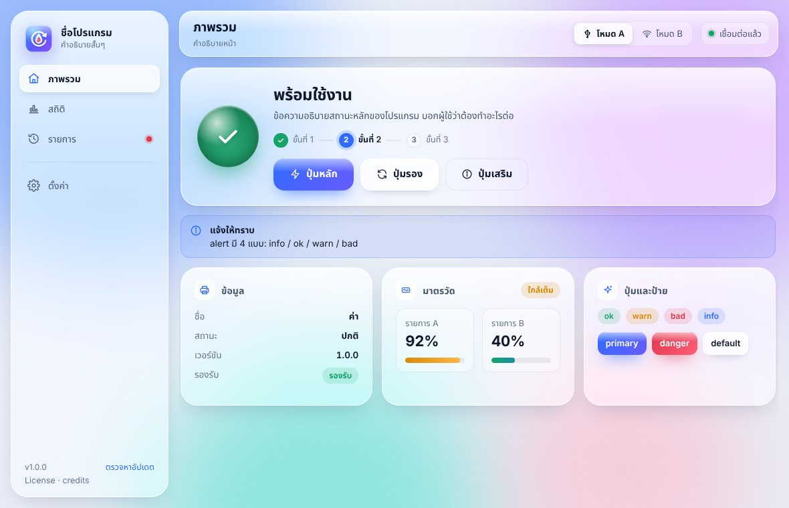

# Glass UI template

เทมเพลตหน้าตาของ Epson Ink Pad Reset แยกออกมาให้ใช้กับโปรแกรมอื่นได้ทันที

## สไตล์นี้เรียกว่าอะไร

**Glassmorphism** (หรือ **Liquid Glass / Frosted Glass**) วางในเลย์เอาต์แบบ **Sidebar Dashboard**

- การ์ดเป็น "กระจกฝ้า" โปร่งแสง เบลอพื้นหลัง (`backdrop-filter: blur() saturate()`) มีขอบสว่างและเงานุ่ม
- พื้นหลังเป็นก้อนสีพาสเทลเบลอ (gradient blobs) ลอยช้าๆ + ลายเกรนบางๆ
- ธีมสว่าง/มืดเปลี่ยนตามระบบ (`prefers-color-scheme`) อัตโนมัติ
- ไอคอนเส้น (line icons) กริด 24px เส้นหนา 1.8 รวมไว้ใน SVG sprite ในไฟล์ HTML
- มุมโค้งมาก (10–26px) ปุ่มหลักไล่สีน้ำเงิน→ม่วง ตัวเลขใหญ่หนา
- ฟอนต์ไทย: Leelawadee UI / Noto Sans Thai / Sarabun

ถ้าจะสั่งให้ AI หรือนักออกแบบทำแบบนี้ ใช้คำว่า: *"glassmorphism sidebar dashboard, frosted glass cards, pastel gradient blobs background, auto light/dark"*

## ไฟล์

ไฟล์ทั้งหมดอยู่ใน `template/`

| ไฟล์ | ใช้ทำอะไร |
|---|---|
| `index.html` | โครงหน้า: sidebar + topbar + หน้าตัวอย่าง 4 หน้า + ชุดไอคอน |
| `style.css` | ดีไซน์ทั้งหมด (ตัวแปรสีอยู่บนสุดใน `:root`) |
| `app.js` | สลับหน้า, `toast()`, `modal()`, `confirmBox()` |
| `logo.svg` | โลโก้ตัวอย่าง เปลี่ยนเป็นของโปรแกรมใหม่ |

เปิด `index.html` ในเบราว์เซอร์ได้เลย ไม่ต้อง build

## เริ่มโปรแกรมใหม่

1. ก๊อปโฟลเดอร์ `template/` ไปเป็น `ui/` ของโปรเจกต์ใหม่ (ไม่ต้องเอา `preview.jpg`)
2. แก้ชื่อใน `<title>`, `.brand-name`, `.brand-sub` และเปลี่ยน `logo.svg`
3. แก้เมนูใน `<nav>` กับ `PAGES` ใน `app.js` ให้ตรงกัน (`data-page="x"` ↔ `<section id="page-x">`)
4. เปลี่ยนสีแบรนด์ที่ `--accent`, `--accent-2` และสีพื้นหลัง `--blob-1..4` (ทำทั้งบล็อกสว่างและ `@media (prefers-color-scheme: dark)`)
5. ถ้าเป็นโปรแกรม Windows ใช้ [pywebview](https://github.com/r0x0r/pywebview) เปิดหน้านี้ แล้วเรียก Python ผ่าน `window.pywebview.api` แบบเดียวกับ `app_web.py` ใน repo [Mark-Notify/Epson-config](https://github.com/Mark-Notify/Epson-config)

## ชิ้นส่วนที่มีให้

| class | หน้าตา |
|---|---|
| `.glass` | พื้นกระจก ใส่กับการ์ดอะไรก็ได้ |
| `.grid.g-12` + `.span-4/5/6/7/8/12` | กริด 12 คอลัมน์ (ย่อจอแล้วเรียงลงเอง) |
| `.card` + `.card-h` + `.icon-tile` | การ์ดมีหัวข้อและไอคอน |
| `.hero` + `.orb.ok/.warn/.bad/.busy` + `.steps` | กล่องสถานะใหญ่ด้านบน ลูกแก้วสี และขั้นตอน |
| `.btn` `.primary` `.danger` `.ghost` `.lg` `.sm` `.icon` | ปุ่ม |
| `.pill.ok/.warn/.bad/.info` | ป้ายสถานะ |
| `.alert.info/.ok/.warn/.bad` | กล่องแจ้งเตือน |
| `.kv` (dl/dt/dd) | รายการ ชื่อ–ค่า |
| `.gauges` `.gauge` `.meter` | มาตรวัดเปอร์เซ็นต์ |
| `.tiles` `.tile` `.section-title` | การ์ดตัวเลขสถิติ |
| `.tools` `.tool` (`--c1`/`--c2`) | การ์ดเครื่องมือมีไอคอนไล่สี |
| `.list` `.row-item` | รายการแถว (ประวัติ, ไฟล์) |
| `.segmented` `.chips` `.chip-btn` `.input` `.search` `input[type=range]` | ตัวเลือกและช่องกรอก |
| `.banner` `.modal` `.toast` `.empty` `.table` | แถบแจ้ง, หน้าต่างยืนยัน, แจ้งเตือนมุมจอ, หน้าว่าง, ตาราง |

`style.css` ยังมีชิ้นเฉพาะของโปรแกรม Epson (`.inks`, `.tube`, `.models`) ไม่ใช้ก็ลบได้
